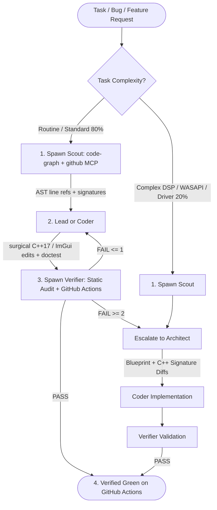

# Triage & Multi-Agent Orchestration Protocol

The **Lead Agent** acts as the primary coordinator, dispatching lightweight subagents for routine work to preserve context and speed, and escalating to `architect` (`pro`) only when real-time audio concurrency, FFmpeg filter/codec pipelines, or WDK kernel driver complexity demands it.

> **Subagent MCP Rule**: Whenever defining a subagent at runtime via `define_subagent`, always set `EnableMCPTools: true` so it can call `github`, `code-graph`, and `drawio`.

---

## 1. Subagent Dispatch Matrix & MCP Tool Routing

Subagents are assigned dedicated roles and MCP tools to prevent context bloat:

| Subagent | Role & Profile | Dedicated Tools & MCPs | Token-Efficiency Contract |
| :--- | :--- | :--- | :--- |
| **`scout`** | Fast / Lightweight (`flash`, `low`) | `code-graph` (`project_map`, `semantic_code_search`, `get_call_graph`), `github`, `view_file` | Queries AST symbol graphs, C++ headers, and GitHub CI/PR state. Never reads whole files unless small. Returns `< 45` lines of file/line pointers and C++ signatures. |
| **`coder`** | Focused Implementation (`flash`, `medium`) | `edit_file`, `write_file`, `view_file`, `run_command` | Applies surgical C++17 / ImGui / CMake / PowerShell replacements. Adds doctest cases for new engine logic. Never rewrites untouched lines. |
| **`verifier`** | Fast QA Validation (`flash`, `low`) | `run_command`, `manage_task`, `view_file` | Performs pre-push static `/W4` & Unicode audit and monitors GitHub Actions (`windows-2022`) build/`ctest` runs. Returns structured 5-line diagnostic. |
| **`architect`** | Deep Reasoning Escalation (`pro`, `medium`) | `code-graph`, `github`, `view_file`, `search_web` | **Invoked only on escalation**. Designs lock-free audio pipelines, FFmpeg 8 filter graphs, and WASAPI clock-drift logic. Returns declarative C++ diffs. |

---

## 2. Execution Phases

### Phase 1: Code & CI Discovery (`scout`)
- When a task references C++ classes, WASAPI/FFmpeg bugs, UI layout in `ControlCenter.cpp`, or GitHub Actions failures, spawn `scout`.
- **AST Lookup**: `scout` queries `code-graph` (`semantic_code_search`, `get_ast_node`, `get_call_graph`) to map affected files and line numbers.
- **GitHub Lookup**: `scout` uses `github` MCP to inspect PRs, branches, or workflow logs without dumping raw logs into the main conversation.

### Phase 2: Implementation (`coder` or Lead)
- For single-file updates, the Lead applies the change directly with `edit_file`.
- For multi-file changes (e.g., `Config.h` + `SpdifEncoder.cpp` + `ControlCenter.cpp` + `test_encoder.cpp`), dispatch `coder` with the `scout` summary.
- **Rule Enforcement**:
  - **Modern FFmpeg 8 API**: Strictly `AVChannelLayout`, `swr_alloc_set_opts2`, `avcodec_send_frame`/`avcodec_receive_packet`.
  - **MSVC `/W4 /permissive-`**: Keep `ac3core` and `control_center` warning-free; use wide Win32 calls (`LoadIconW`, etc.) in `ControlCenter.cpp`.
  - **TDD**: Add or update doctest unit tests in `engine/test/test_*.cpp` for new encoder, upmix, config, or ring-buffer behavior.

### Phase 3: Static Audit & GitHub Actions Verification (`verifier`)
- Because builds run on **GitHub Actions (`windows-2022`)**, `verifier` performs a pre-push static C++17/Win32 audit first, and once pushed, checks the GitHub Actions run (`gh run list` / `gh run view --log-failed`) to verify `cmake --build`, `ctest`, and `ISCC.exe` installer packaging succeed.

---

## 3. Escalation Protocol: When to Call `architect`

Invoke `architect` (`pro`) **ONLY** under these conditions:
1. **Real-Time Audio & Clock Drift**: Stuttering, underruns/overruns, WASAPI loopback polling vs. exclusive event-driven render timing, or `RingBuffer` synchronization.
2. **FFmpeg 8 Filter & Codec Graphs**: Complex `libavfilter` chains (`surround` upmix, dynamic channel steering, `AVAudioFifo` latency priming) or IEC 61937 S/PDIF framing (`AC3` / `DTS`).
3. **Cross-Cutting Bugs**: Any issue spanning 3+ files across capture, encoder, render, and GUI control state.
4. **Retry Threshold**: When GitHub Actions or `verifier` fails twice on the same compiler, linker, or doctest failure.
