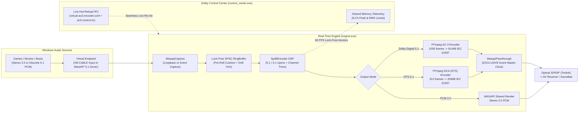
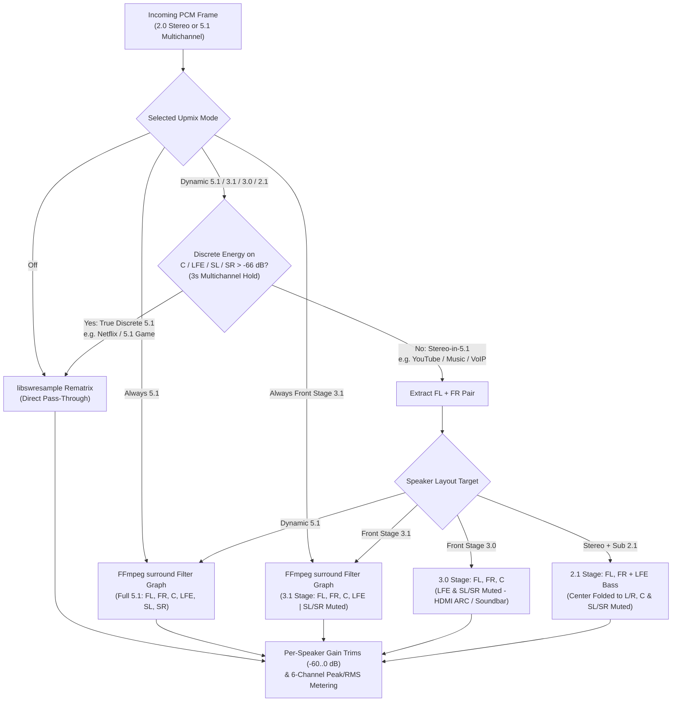

# Dolby Control Center (`virtual-ac3-encoder`)

[](https://github.com/PatalJunior/virtual-ac3-encoder/actions/workflows/ci.yml)
[](LICENSE)

A real-time Windows 10/11 software implementation of **Dolby Digital Live (DDL)** and **DTS Connect** — a virtual surround audio processor and **DirectX 11 Control Center** that captures stereo or 5.1 PCM audio, encodes it in real time to **DTS 5.1**, **Dolby Digital (AC-3) 5.1**, or **PCM Stereo 2.0**, wraps it as an **IEC 61937 / S-PDIF** bitstream, and streams it over a single **Toslink optical** cable to your AV receiver or soundbar.

> **Why this exists:** Optical (S/PDIF / Toslink) only has enough bandwidth for uncompressed **2.0 stereo PCM** *or* a compressed **5.1 bitstream** (Dolby Digital / DTS) — never uncompressed 5.1 PCM. Most modern motherboards and USB DACs (Realtek, etc.) omit Dolby Digital Live and DTS Interactive licensing, leaving PC games, movies, and music stuck in 2.0 stereo over optical. This project performs the real-time 5.1 encoding and stereo-to-surround upmixing in software with ultra-low latency.

---

## Key Features

| Feature | Details |
| :--- | :--- |
| **Multi-Format Digital Output** | **DTS Core 5.1** (`1536 kbps` full-rate / `768 kbps` half-rate), **Dolby Digital AC-3 5.1** (`640 kbps` / `448 kbps`), and **PCM Stereo 2.0** over **Toslink Optical (S/PDIF)** or **HDMI ARC**. |
| **Smart Multi-Layout Upmixing (`5.1` / `3.1` / `3.0` / `2.1`)** | **Dynamic Surround 5.1** (auto-detects stereo inside 5.1 streams and upmixes to all 6 speakers while passing true discrete 5.1 untouched), **Front Stage 3.1** (`FL+FR+C+LFE`), **Front Stage 3.0** (`FL+FR+C`, ideal for 3.0 HDMI ARC soundbars), **Stereo + Sub 2.1** (`FL+FR+LFE`), **Always 5.1 / 3.1**, or **Off**. |
| **Dolby Control Center (DX11 GUI)** | Hardware-accelerated **Dear ImGui + DirectX 11** dark studio UI with **60 FPS 6-channel VU meters** (peak hold + dB readouts), per-speaker level trims (`-60 dB` to `0 dB` + mute), live hot-reload (zero audio interruption when changing modes/trims), and system tray integration. |
| **5-Tier Latency Presets** | **Extreme** (`~3 ms`), **Fast** (`~7 ms`), **Balanced** (`~12 ms`, default), **Safe** (`~20 ms`), and **Relaxed** (`~35 ms`), backed by a lock-free SPSC ring buffer and master-clock drift compensation. |
| **Flexible Audio Capture** | Works out-of-the-box with **Secure Boot ON** via **[VB-CABLE](https://vb-audio.com/Cable/)** (WASAPI loopback or recording capture), or with the included **WDK WaveRT Virtual 5.1 Driver** (`driver/`). |

---

## System Architecture & Audio Flowcharts

### 1. End-to-End Real-Time Pipeline



### 2. Dynamic Stereo & Surround Upmix Decision Flow



---

## Quick Start (Download & Install)

### 1. Install VB-CABLE (Virtual Audio Device)
1. Download and install **[VB-CABLE](https://vb-audio.com/Cable/)**.
2. Open **Windows Sound Settings (`mmsys.cpl`)**:
   - Set **CABLE Input (VB-Audio Virtual Cable)** as your **Default Playback Device**.
   - *(Optional)* Select **CABLE Input** -> **Configure** -> **5.1 Surround** (or leave as Stereo and let **Dynamic Surround 5.1** / **Front Stage 3.1** upmix automatically).
3. Connect your PC's **Optical (S/PDIF / Toslink)** port to your AV receiver or soundbar.

### 2. Install Dolby Control Center
Download the latest release from **[Releases](https://github.com/PatalJunior/virtual-ac3-encoder/releases/latest)**:
- **`virtual-ac3-encoder-setup-x.y.z.exe`** *(Recommended)* — Per-user installer (no admin required). Installs **Dolby Control Center**, sets up automatic system-tray startup at Windows logon, and adds Start Menu shortcuts.
- **`virtual-ac3-encoder-x.y.z-win64.zip`** — Portable zip; extract anywhere and run `control_center.exe` (or `engine.exe` from CLI).

---

## Dolby Control Center Guide

### Output Modes
- **DTS 5.1 Surround (`1536 kbps` / `768 kbps`)**: Highest-bitrate optical surround (`512`-sample frames for ultra-low latency).
- **Dolby Digital 5.1 (`640 kbps` / `448 kbps`)**: Universal AC-3 optical bitstream supported by virtually all AV receivers and soundbars.
- **PCM Stereo 2.0**: Uncompressed stereo pass-through over WASAPI shared mode.

### Stereo Upmix & Speaker Layout Modes
- **Dynamic Surround 5.1 (Default)**: Automatically detects whether the audio playing is stereo (music, YouTube, stereo games, Discord) or discrete 5.1 (movies, surround games). Stereo sources are upmixed across all 5.1 speakers; true 5.1 sources (including Center-only dialogue) pass through untouched with a 3-second hold window.
- **Front Stage 3.1 (Home Theater Recommended)**: Dynamically steers vocals to the **Center** speaker and deep bass to the **Subwoofer (LFE)** while keeping rear surrounds completely silent.
- **Front Stage 3.0 (HDMI ARC / Soundbar)**: Dynamically steers vocals to the **Center** speaker alongside **Front Left & Right** while keeping both Subwoofer (LFE) and rear surrounds silent — ideal for 3.0 soundbars and LCR setups without a dedicated subwoofer.
- **Stereo + Sub 2.1 (Bookshelf + Subwoofer)**: Extracts low-frequency bass (`< 140 Hz`) to the **Subwoofer (LFE)** while folding centered vocals back into **Front Left & Right** and keeping Center and rear surrounds silent.
- **Always Surround 5.1 / Always Front Stage 3.1**: Forces upmixing unconditionally on all inputs.
- **Off**: Pure 1:1 channel mapping with no upmix filter.

### Speaker Level Trims & Master Release
- **6-Speaker Trims (`FL`, `FR`, `C`, `LFE`, `SL`, `SR`)**: Adjust any speaker from `-60 dB` to `0 dB` or toggle **Mute** in real time while audio is playing.
- **Master Power Button**: Click `[ ACTIVE: ENCODING TO S/PDIF ]` at the top of the window (or via the system tray icon) to immediately stop encoding and release exclusive ownership of the optical port.

---

## CLI Reference (`engine.exe`)

While `control_center.exe` manages `engine.exe` automatically, you can also run `engine.exe` standalone:

```powershell
# List all playback and recording endpoints
engine.exe --list

# Probe which playback endpoints support AC-3 passthrough
engine.exe --probe

# Capture "CABLE Input" via WASAPI loopback and output AC-3 5.1 to Realtek Digital Output
engine.exe --loopback --in "CABLE Input" --out "Realtek Digital Output"

# Capture "CABLE Output" recording endpoint directly
engine.exe --in "CABLE Output" --out-spdif --bitrate 640000 --upmix surround
```

| Flag | Description |
| :--- | :--- |
| `--list` | List all active Windows render and capture endpoints. |
| `--probe` | Query `IAudioClient::IsFormatSupported` for IEC 61937 AC-3 support on all render endpoints. |
| `--mon` | Run a 5-second capture-only throughput diagnostic. |
| `--loopback` | Capture `--in` as a *render* endpoint via WASAPI loopback (default for `CABLE Input` / virtual driver). |
| `--in <name>` / `--in-id <id>` | Capture device friendly-name substring or exact endpoint ID. |
| `--out <name>` / `--out-id <id>` | Optical output device friendly-name substring or exact endpoint ID. |
| `--out-spdif` | Automatically pick the first render endpoint with an `SPDIF` form factor. |
| `--bitrate <bps>` | AC-3 bitrate (`640000` or `448000`). |
| `--safe <frames>` | Target ring-buffer drift floor in sample frames. |
| `--upmix <mode>` | `surround` (`5.1`), `front` (`3.1`), `3.0`, `2.1`, `always`, `always_front`, or `off`. |
| `--config <path>` | Path to config file (defaults to `virtual-ac3-encoder.conf` next to `engine.exe`). |
| `--hidden` / `--log <path>` | Run with hidden console window / append output to log file. |

---

## Building from Source

### 1. User-Mode Engine & Dolby Control Center (`engine/`)
Requires **Visual Studio 2022** (Desktop development with C++ workload), **CMake 3.20+**, and **PowerShell**:

```powershell
# 1. Fetch prebuilt FFmpeg 8 shared dev libraries & Dear ImGui sources
.\scripts\fetch-ffmpeg.ps1
.\scripts\fetch-imgui.ps1

# 2. Configure & build Release x64 targets (ac3core, engine, control_center, encode_wav, unit_tests)
cmake -S engine -B engine\build -G "Visual Studio 17 2022" -A x64
cmake --build engine\build --config Release

# 3. Run the doctest unit test suite
ctest --test-dir engine\build -C Release --output-on-failure
```

### 2. Optional Kernel Virtual 5.1 Driver (`driver/`)
Derived from Microsoft's WaveRT `SimpleAudioSample`, configured as a single 5.1 render-only endpoint (`KSAUDIO_SPEAKER_5POINT1`, 48 kHz 16-bit). Requires **WDK 10.0.26100** and **Secure Boot OFF** (for test-signed loading):

```powershell
# Build with 64-bit MSBuild
& "C:\Program Files\Microsoft Visual Studio\2022\Community\MSBuild\Current\Bin\amd64\MSBuild.exe" `
  driver\SimpleAudioSample.sln /p:Configuration=Release /p:Platform=x64 /p:SpectreMitigation=false

# Install (Elevated PowerShell, Secure Boot OFF):
.\scripts\install-driver.ps1 -EnableTestSigning   # Reboot after enabling test signing
.\scripts\install-driver.ps1
```

---

## License & Attributions

Licensed under the **MIT License** — see [`LICENSE`](LICENSE).
- Real-time master-clock ring-buffer architecture modeled on [SoundPusher](https://codeberg.org/q-p/SoundPusher) (MIT, Daniel Vollmer).
- Kernel virtual audio driver derived from Microsoft's [Windows Driver Samples `SimpleAudioSample`](https://github.com/microsoft/Windows-driver-samples) (MIT).
- Dynamically links **FFmpeg** (LGPL) and uses **Dear ImGui** (MIT) for the DirectX 11 Control Center. Full attributions in [`NOTICE.md`](NOTICE.md).
